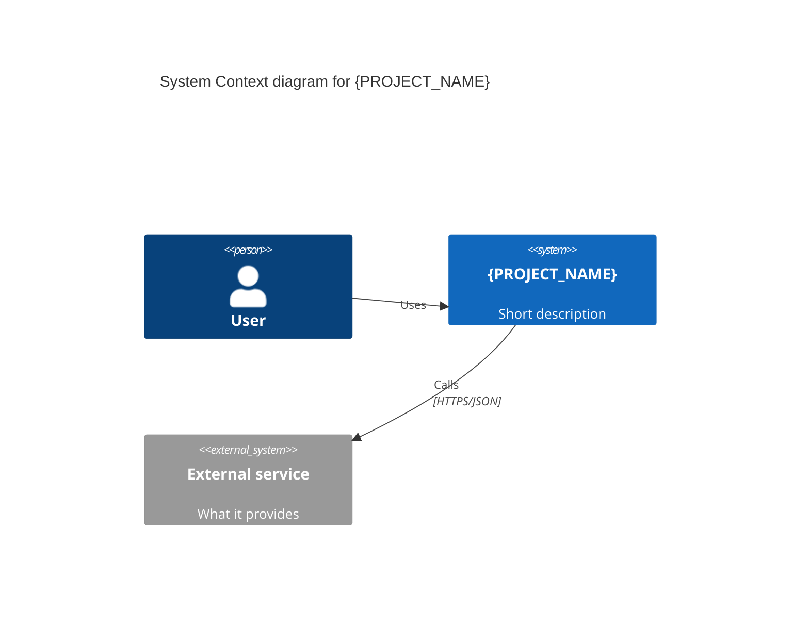

# AGENTS.md

Instructions for contributors and AI agents working on this repository.

## Project

**Tabuada 12** is a free, static web app that helps children practise
multiplication tables from 1 to 12. A chosen animal mascot asks random
questions, the child gets two attempts, and wrong answers are revisited more
often.

- Live app: <https://tabuada12.miguelduarte.eu/>
- Repository: <https://github.com/mcduarte2000/tabuada12>
- Licence: MIT (see `LICENSE`)
- Language of the UI: European Portuguese (pt-PT)
- Language of code, comments-free identifiers, docs and ADRs: English
- Docs language: English, except `README.md`/`CHANGELOG.md` which stay in
  Portuguese because they are the public project page

## Stack and constraints

- Plain HTML, CSS and JavaScript. No framework, no bundler, no build step, no
  `package.json`.
- All state lives in the browser (cookies and `localStorage`). There is no
  backend and there must not be one.
- Target: free static hosting (GitHub Pages, Cloudflare Pages/Workers assets).
- Must work from a 320 px wide viewport, with touch, keyboard and dark mode.
- No analytics, no tracking, no third-party scripts at runtime. The only
  external request is Google Fonts (Roboto).
- Do not add dependencies without an ADR.

## Files and folders

```
index.html            single page shell
styles.css            Material Design 3 tokens, layout, components
app.js                all game logic (IIFE, no modules, ES5 syntax)
mascots.js            mascot list and fallback phrases
content.json          per-mascot phrases, fetched at runtime (editable)
manifest.webmanifest  PWA metadata
assets/               icons, mascot SVGs, vendored licence
docs/                 documentation: architecture, requirements, tests
tests/regression.js   dependency-free regression suite
CHANGELOG.md          Keep a Changelog + SemVer
```

Editing `content.json` requires an HTTP server (`python3 -m http.server`),
because `fetch` is blocked on `file://`.

## Code conventions

- ES5 syntax (`var`, `function`) and one IIFE in `app.js`. Keep it that way so
  the file runs without transpiling.
- No comments in code. Comments are only acceptable when they explain a
  non-obvious browser quirk or licensing fact.
- Keep the single source of truth for magic numbers at the top of `app.js`
  (`STORAGE`, `COOKIE`, `PRIORITY`, TTL constants).
- Text in the UI is pt-PT and child-facing: short, active voice, no jargon.
- Accessibility is not optional: every interactive element is a `<button>`
  with an accessible name, live regions for feedback, `prefers-reduced-motion`
  honoured, contrast inherited from M3 tokens.
- Verify changes in a browser at 320x568, 390x844 and desktop, light and dark,
  before committing.

## Documentation rules

All architecture documentation lives in `docs/` and is versioned with the code
(docs-as-code). The following rules are mandatory.

### 1. File and folder structure

```
docs/
├── README.md                        # general documentation index
├── architecture/
│   ├── README.md                    # architecture section index
│   ├── overview.md                  # arc42 sections 1-4
│   ├── building-blocks.md           # arc42 sections 5-8
│   ├── quality-and-risks.md         # arc42 sections 10-11
│   └── adr/
│       ├── README.md                # ADR index
│       └── NNNN-slug.md             # one ADR per decision
├── requirements/
│   ├── README.md                    # requirements index and format rules
│   └── iteration-NN.md              # one file per closed iteration
└── tests/
    └── README.md                    # what the regression suite covers
```

Justification for `tests/`: the test runner lives in `tests/regression.js` and
its catalogue is documentation, so it belongs under `docs/tests/`. Keeping the
catalogue next to the architecture and requirements means a defect fix must
update all three in the same commit.

Justification for `requirements/`: architecture says *how* the system is built,
requirements say *what* was asked and *how it was verified*. Keeping them apart
prevents product intent from being mixed with design rationale.

Do not invent new folders beyond these without justifying it in the pull
request.

### 2. File naming

- Folder and file names: lowercase, kebab-case, ASCII only.
  `building-blocks.md`, never `Building_Blocks.md`.
- Forbidden: spaces, accents, camelCase, snake_case.
- ADRs: `NNNN-short-slug.md`, sequential monotonic numbering
  (`0002-use-postgresql.md`). Never renumber; gaps are acceptable.
- Conventional root exceptions: `README.md`, `CHANGELOG.md`,
  `CONTRIBUTING.md`, `AGENTS.md`, `SECURITY.md`, `LICENSE`.
- Every folder has a `README.md` acting as an index with relative links to the
  documents it contains.

### 3. Diagrams: C4 model with Mermaid

- Use the C4 model (context, container, component) in Mermaid blocks embedded
  in Markdown.
- One diagram per `mermaid` block, complete and self-contained. Never leave a
  block half-written or mix grammars.
- Each diagram has a Markdown heading and a caption sentence before the fence,
  outside the block.
- Notation: `Person` and `System_Ext` for people and external systems, the
  system under study as `System`. Label arrows with protocol/technology.
- Do not draw level 4 (code) unless explicitly requested. Default maximum
  detail: context and container.
- Always start with the context diagram. Move to containers only when the
  system has more than one.
- If a diagram has more than ~10 elements, split it.

Example of level 1:

````markdown
### System context

The child and the optional supervising adult interact only with the web app.


````

### 4. Decisions: ADRs in MADR format

One file per decision:

```markdown
# NNNN. Imperative title of the decision

* Status: accepted (or proposed / superseded by ADR-MMMM)
* Date: YYYY-MM-DD

## Context and problem statement

{Why this decision was needed}

## Considered options

### Option A
Pros: ... / Cons: ...

### Option B
Pros: ... / Cons: ...

## Decision outcome

We chose option X, because {decisive reason}.

### Consequences

* Positive: ...
* Negative / risks: ...
```

Rules: record only hard-to-reverse decisions with real alternatives.
Formatting conventions and trivial choices do not get an ADR. When an ADR
replaces another, mark the old one `superseded by ADR-MMMM` and link them.
The newest ADR uses the next free number.

### 5. Main document content (arc42-inspired)

- `overview.md` covers, in this order: introduction and quality goals,
  constraints, context and scope (with the context diagram), solution
  strategy.
- `building-blocks.md` describes the module/container decomposition with the
  container diagram.
- `quality-and-risks.md` covers quality requirements, risks and technical
  debt.
- Write a section only when it has real content. Write `n/a` instead of
  filling it with empty text.

### 6. Writing style

- Short sentences, active voice, no marketing words ("blazing fast",
  "powerful").
- Do not invent details. When something is unknown, write
  `TODO: confirm` instead of guessing.
- Relative links between documents (`./adr/0002-use-postgresql.md`), never
  absolute.
- English for document content, unless stated otherwise.

### 7. Requirements per iteration

- One file per **closed** iteration: `docs/requirements/iteration-NN.md`,
  zero-padded, lowercase, kebab-case.
- Every requirement has three layers, all in English:
  1. **User story** — `US-n`, in the form "As a ..., I want ..., so that ...".
  2. **EARS requirements** — `R<iteration>.<n>`, tagged with the EARS pattern
     in parentheses: Ubiquitous ("shall"), Event-driven ("When ..."), 
     State-driven ("While ..."), Optional feature ("Where ..."), Unwanted
     behaviour ("If ... then ...").
  3. **Acceptance criteria** — Gherkin `Feature` and `Scenario` blocks with
     `Given`/`When`/`Then` that a tester can run without reading the code.
- Record only behaviour that is implemented and verified. If a criterion
  disagrees with the code, fix one of them before marking the iteration
  `completed`.
- Add a **Verification record** table with the method used per requirement
  group, and a **Known gaps** list.
- Never renumber requirements. Mark removed ones as removed.
- Update the index table in `docs/requirements/README.md` and `CHANGELOG.md`
  in the same commit.

### 8. Update discipline

Every development iteration must update the whole documentation set to match
the code: `overview.md` when constraints, goals or context change,
`building-blocks.md` when the decomposition changes, `quality-and-risks.md`
when risks or debt appear or close, a new ADR for a new architectural
decision, a new iteration file in `docs/requirements/` when an iteration
closes, and `CHANGELOG.md` for user-visible changes.

## Third-party content and licensing

- The project is MIT. The root `LICENSE` file holds the MIT text for the
  project, followed by a **Third-party notices** section.
- Every external asset, font, design system or code fragment must be listed
  there with: work title, author, source URL, licence name, licence URL and
  the files it covers.
- Vendored assets also keep their upstream licence file next to them, for
  example `assets/mascots/fluent/LICENSE-fluentui-emoji.md`.
- Never add content whose licence is unclear, "free to use" without a named
  licence, or incompatible with MIT redistribution. Ask for an ADR first.
- When adding or removing third-party files, update `LICENSE` in the same
  commit and keep the file list in sync with the disk contents.

## Tests

- `node tests/regression.js` must pass before any commit that changes
  behaviour. It exits non-zero on failure.
- Static checks need no browser. Browser checks use Playwright when available,
  otherwise the system Chrome.
- When a defect is found, add a failing check first, then fix it. Name the check
  after the behaviour it protects.
- Never delete a check to make the suite pass. If a requirement changed, update
  the check and the requirement together.
- The catalogue of covered defects lives in `docs/tests/README.md`; update it
  in the same commit as the test.

## Versioning and changelog

- `CHANGELOG.md` follows [Keep a Changelog](https://keepachangelog.com/en/1.1.0/)
  and [Semantic Versioning](https://semver.org/).
- New user-visible work goes under `[Unreleased]` and is promoted to a version
  on release, with an annotated git tag `vX.Y.Z`.
- Breaking the stored-data format in a way that loses old data is a MAJOR
  change.

## Git

- Commits are imperative and describe the change, not the file touched.
- Do not commit `.DS_Store`, editor folders, or build output.
- Do not commit secrets. There are none in this project today, and the
  architecture does not need any.
