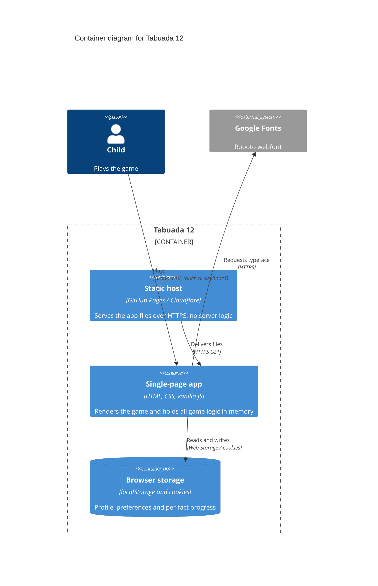
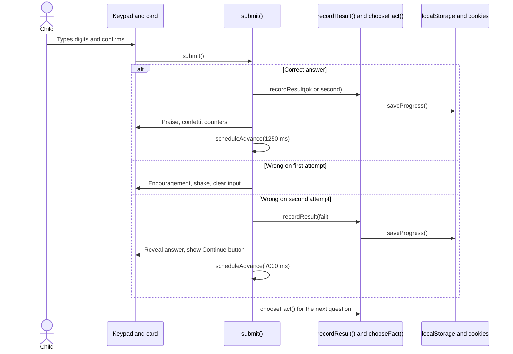

# Building blocks

Decomposition of Tabuada 12 in arc42 sections 5 to 8.

## 5. Building block view

### 5.1 Container diagram

The system has two runtime containers: the static host, which only serves
files, and the browser application, which holds all logic and state. Browser
storage is drawn as a separate data store because persistence is a first-class
concern.



### 5.2 Static assets

| File | Role |
| --- | --- |
| `index.html` | Document shell, setup form, game screen, stat panel, keypad, licence and privacy dialog, inline SVG icons. |
| `styles.css` | Material Design 3 tokens, light and dark palettes, layout, components, motion. Mascot picker is a horizontal carousel with page dots and a scroll hint; line heights are unitless so text scales with the system font size; the header sits at the top of the page and stacks a left-aligned row with the static app icon and title above a right-aligned row of action buttons, while the speaking mascot and its name render beside the speech bubble. |
| `app.js` | Entire game logic in one IIFE, ES5 syntax. |
| `mascots.js` | `window.MASCOTS` list (30 entries: id, name, image path, background colour) and `window.FALLBACK_CONTENT`. |
| `content.json` | Per-mascot phrase pools and generic pools, fetched at runtime. |
| `manifest.webmanifest` | PWA metadata and icon set. |
| `assets/mascots/fluent/*.svg` | 30 Fluent Emoji mascots plus the upstream MIT licence. |
| `assets/icon.svg`, `icon-192.png`, `icon-512.png`, `apple-touch-icon.png` | App icons. |

### 5.3 Modules inside `app.js`

`app.js` is one IIFE with no imports. Blocks are grouped by responsibility.

| Block | Representative functions | Responsibility |
| --- | --- | --- |
| Constants and state | `STORAGE`, `COOKIE`, `PROGRESS_TTL`, `PROFILE_TTL`, `COOKIE_LIMIT`, `PRIORITY`, `state` | Single source of truth for magic numbers and mutable session data. |
| Persistence | `readStored`, `writeStored`, `setCookie`, `getCookie`, `setProfileCookies`, `readProfileCookies`, `readProgress`, `saveProgress`, `encodeProgress`, `decodeProgress`, `readRecords`, `writeRecords`, `encodeRecords`, `decodeRecords` | Dual-write profile, progress and top-10 records; progress expires after 24 h, name, mascot and records after one year; tolerate corrupt or missing data. |
| Content and phrasing | `fill`, `phrases`, `mascotPhrases`, `pickFresh`, `loadContent` | Load `content.json`, substitute placeholders, avoid repeating the previous phrase. |
| Adaptive selection | `factKey`, `factWeight`, `chooseFact`, `recordResult` | Weighted random choice per fact and progress recording. |
| Game flow | `newQuestion`, `pressDigit`, `pressDelete`, `submit`, `nextQuestion`, `scheduleAdvance` | Attempt counting, correct/wrong/reveal phases, automatic advance. |
| Session statistics | `renderStats`, `formatTime`, `renderTime`, `startTimer`, `stopTimer`, `updateBest`, `recordBest`, `resetStreak`, `renderSessionDialogs`, `renderRecords`, `openDialog` | Correct count, miss count, streak, record history, elapsed time, and the detail dialogs behind each indicator. |
| Rendering and feedback | `say`, `react`, `setAvatar`, `applyThemeColors`, `bump`, `restartAnimation`, `burstConfetti`, `spawnRipple` | Bubble text, mascot animation, ripple and confetti effects. |
| Audio | `ensureAudio`, `beep`, `soundCorrect`, `soundWrong`, `soundReveal` | Synthesised feedback tones, no files. |
| Setup flow | `renderMascotOptions`, `selectMascot`, `ownedHello`, `startGame`, `goToMascotStep`, `resetToSetup`, `applyTheme`, `updateThemeButton`, `updateSoundButton` | Name entry, mascot choice, profile switching, preferences. |

### 5.4 Data held in memory

`state` is the only mutable object during a session:

| Field | Meaning |
| --- | --- |
| `name`, `mascot` | Current profile. |
| `content` | Merged phrase catalogue from `content.json` plus fallback. |
| `lastPhrase` | Last phrase used per category, to avoid immediate repetition. |
| `a`, `b`, `input`, `attempt`, `phase`, `busy` | Current question and interaction state. |
| `correctCount`, `missCount`, `streak`, `best` | Session and lifetime counters. |
| `firstTryCount`, `secondTryCount`, `missFirst`, `missSecond` | Session breakdown shown in the Acertos and Falhas dialogs. |
| `records` | Top-10 streak history, persisted in `localStorage` and a one-year cookie. |
| `sound` | Whether sound effects are enabled. |
| `startedAt`, `timerId` | Session clock. |
| `progress` | Per-fact counters: `ok`, `second`, `fail`, `last`, `lastOk`. |

## 6. Runtime view

### 6.1 Answering one question

The child types digits, confirms, and the app decides between praise, second
attempt or reveal.



### 6.2 Cold start

`init()` reads preferences and progress, renders the mascot grid, restores the
last name and mascot, then fetches `content.json`. If the fetch fails, the
built-in fallback phrases are used and the game continues.

## 7. Deployment view

### 7.1 Current deployment

Static files are served from a Git branch. Two equivalent targets exist.

```mermaid
C4Deployment
  title Deployment diagram for Tabuada 12
  Deployment_Node(gh, "GitHub", "github.com") {
    Container(repo, "Repository mcduarte2000/tabuada12", "Git branch main", "Source of truth")
    Deployment_Node(pages, "GitHub Pages", "CDN") {
      Container(files, "Static files", "HTTPS", "index.html and assets")
    }
  }
  Deployment_Node(cf, "Cloudflare", "Workers and Pages") {
    Container(cfw, "Workers assets", "HTTPS", "Same static files, wrangler.jsonc")
  }
  Deployment_Node(device, "Child device", "Phone, tablet, desktop") {
    Container(browser, "Browser", "Chrome, Safari, Firefox", "Runs app.js")
  }

  Rel(repo, pages, "Publishes", "Git push")
  Rel(repo, cfw, "Deploys", "Git integration")
  Rel(pages, browser, "Serves", "HTTPS")
  Rel(cfw, browser, "Serves", "HTTPS")
```

### 7.2 Infrastructure requirements

- HTTPS. Required for `Secure` cookies and for PWA installation.
- Correct MIME types for `.json`, `.webmanifest` and `.svg`. Both providers
  handle this with defaults.
- `.nojekyll` on GitHub Pages so asset paths are served verbatim.
- No rewrite rules. Paths in the app are relative.

## 8. Cross-cutting concepts

| Concept | Implementation |
| --- | --- |
| Internationalisation | Not implemented. All UI strings are pt-PT literals in `index.html` and `app.js`. `TODO: confirm` whether other languages are planned. |
| Theming | CSS custom properties on `:root`, switched with `data-theme="light"` or `"dark"` on `<html>`. The value is stored and applied before first paint by a small inline script to avoid a flash. |
| Error tolerance | Every storage read and write is wrapped in `try`/`catch`. Corrupt cookies, expired progress and failed fetches all degrade to a working game. |
| Accessibility | Semantic headings, `<button>` for every control, `aria-pressed` on toggles, `aria-live` on the mascot bubble and the screen-reader question, focus-visible outlines, `prefers-reduced-motion` disables animation. Layout tolerates enlarged system fonts: unitless line heights, wrapping statistic items and a two-line header subtitle. |
| Motion | Short durations (90-560 ms), standard and emphasised easing curves; all motion is decorative and optional. The carousel hint pulses with a 1.6 s nudge animation and stops when disabled by reduced-motion. |
| Transparency | A dialog reachable from every screen states the licence and the local-only storage policy. Its text is static HTML, so it cannot drift from the code by rendering user data. |
| Security | No `innerHTML` with user input. The only dynamic HTML is a fixed icon table. No eval, no remote scripts. Cookies are `SameSite=Lax`, `Secure` on HTTPS, and hold no identifiers. |
