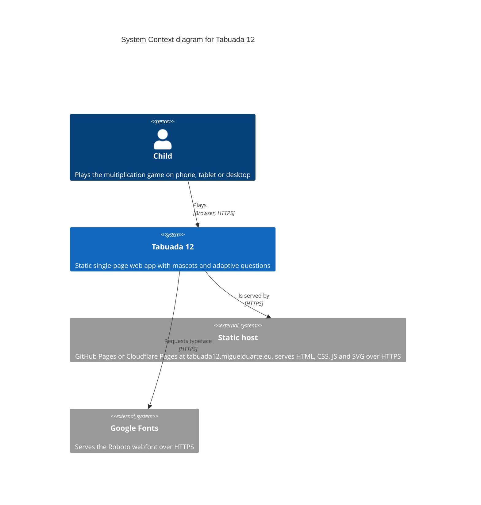

# Overview

Tabuada 12 in arc42 sections 1 to 4: what the system does, which quality goals
drive it, what limits the design, who uses it, and the strategy chosen to
satisfy all of that.

## 1. Introduction and goals

Tabuada 12 is a free web app where a child practises the multiplication tables
from 1 to 12. It is published at <https://tabuada12.miguelduarte.eu/>.

A mascot animal chosen by the child asks random questions. The child has two
attempts; after a second mistake the correct answer is shown and the game moves
on. Questions the child failed come back more often than ones already mastered.

There is no account, no server and no cost to host. Everything runs in the
browser and everything the game learns about the child stays on the device.

### Quality goals

Ranked by importance. Each goal has a short scenario that makes it testable.

| Priority | Goal | Scenario |
| --- | --- | --- |
| 1 | Learning effectiveness | A child who fails 3x4 sees 3x4 again sooner than a table already answered correctly, and the app shows the right answer after two mistakes. |
| 2 | Child-friendly usability | A 7-year-old reaches the first question in under 30 seconds on a phone, without reading instructions. |
| 3 | Zero cost, zero operations | The complete app is served by free static hosting; there is no database, no server process, no uptime concern. |
| 4 | Privacy by design | No personal data leaves the device. No analytics, no third-party runtime scripts. |
| 5 | Accessibility and reach | The app is usable at 320 px wide, with touch and keyboard, in light and dark mode, and honours `prefers-reduced-motion`. |
| 6 | Maintainability | A contributor can change wording or mascots without touching game logic. |

### Stakeholders

| Stakeholder | Expectation |
| --- | --- |
| Child (primary user) | Play immediately, be praised, never be stuck or scolded. |
| Parent or teacher | Free, safe, no ads, works offline-ish, visible progress. |
| Maintainer | Small codebase, no build step, no dependency churn. |
| Hosting provider | Static files only. |

## 2. Constraints

### Technical constraints

- **Static hosting only.** GitHub Pages or Cloudflare Pages/Workers assets.
  No server-side code, no database.
- **No build step.** Plain HTML, CSS and JavaScript. No bundler, no
  transpiler, no `package.json`.
- **ES5 syntax** in `app.js`, inside a single IIFE, so the file runs as-is in
  any browser without tooling.
- **Browser storage only** for state: `localStorage` and cookies.
- **One external request at runtime**: Google Fonts (Roboto). Everything else
  is local.

### Organisational constraints

- Open source under the MIT licence.
- Documentation and code identifiers in English; user interface in European
  Portuguese (pt-PT).
- No budget for paid services or proprietary components.

### Conventions

- Mascot images come from Microsoft Fluent Emoji (MIT).
- Versioning follows Semantic Versioning; changes are tracked in
  [`CHANGELOG.md`](../../CHANGELOG.md).

## 3. Context and scope

### 3.1 Business context

The child plays alone. A parent or teacher may sit beside the child, mainly to
choose the mascot and name on first use. The app has no integration with school
systems, no accounts and no sharing features.

### 3.2 Technical context

The system context below shows the only runtime actors and the only external
system contacted.

#### System context

The child is the only runtime actor; the static host serves files and Google
Fonts provides the typeface.

### 3.3 Interfaces

| Interface | Direction | Description |
| --- | --- | --- |
| HTTPS GET | host → app | Serves `index.html`, `styles.css`, `app.js`, `mascots.js`, `content.json`, `manifest.webmanifest`, `sw.js` and `assets/**`. |
| HTTPS GET | app → Google Fonts | Roboto CSS and font files. Fails gracefully: the app falls back to system fonts. |
| `localStorage` | app → browser | Nickname chosen by the child, mascot, record, theme, sound preference and the full per-fact progress with recency. |
| Cookies | app → browser | Name and mascot (1 year) plus compact progress (24 hours). |
| Web Audio API | app → browser | Synthesises feedback sounds; no audio files are downloaded. |

### 3.4 Out of scope

- User accounts, cloud sync and leaderboards.
- Multiplayer.
- Native mobile packaging. Evaluated but not implemented; see
  [building-blocks.md](./building-blocks.md) for the deployment view.
- Audio music playback. Removed after an intermediate version; only
  synthesised sound effects remain.

## 4. Solution strategy

| Quality goal | Strategy |
| --- | --- |
| Learning effectiveness | Weighted random selection per fact. Failed facts get a weight that grows with the number of failures; mastered facts get a weight that shrinks with each first-try success. Recency dampening avoids repeating a fact answered seconds ago. Implemented in `chooseFact()`/`factWeight()`, documented in [ADR-0004](./adr/0004-adaptive-fact-selection.md). |
| Child-friendly usability | Single screen, one numeric keypad, no text input during play, large touch targets (48 px minimum), praise instead of scolding, automatic advance after a correct answer. |
| Zero cost, zero operations | One HTML file, four local scripts, one JSON file and SVG assets. Installed from the browser with no store, no toolchain and no signing. Hosted from a Git branch, documented in [ADR-0001](./adr/0001-static-single-page-app.md) and [ADR-0008](./adr/0008-installable-web-app.md). |
| Privacy by design | All state in the browser. No network call carries user data. The app asks for a fun nickname and explicitly discourages the real name, and the field disables personal-name autofill. Documented in [ADR-0005](./adr/0005-browser-local-storage-only.md). |
| Accessibility and reach | Material Design 3 tokens, responsive layout from 320 px, keyboard support, live regions, reduced-motion handling. |
| Maintainability | Text and mascot data separated from logic in `content.json` and `mascots.js`; magic numbers centralised at the top of `app.js`; no dependencies to upgrade. |

### Technology decisions

- **Material Design 3** for visual language and colour tokens, so the app looks
  intentional without a component library.
- **Fluent Emoji SVG assets** instead of commissioned art, giving 30 consistent
  mascots under MIT without a design dependency.
- **Web Audio API oscillators** for feedback sound, so no binary assets are
  needed and the app stays fully offline-capable.
- **Progressive Web App** with a manifest and a service worker, so the app
  installs from Chrome or Edge on Android with the built-in prompt and starts
  offline after the first visit. See
  [ADR-0008](./adr/0008-installable-web-app.md).

All architectural decisions are listed in the [ADR index](./adr/README.md).
